# Preamble

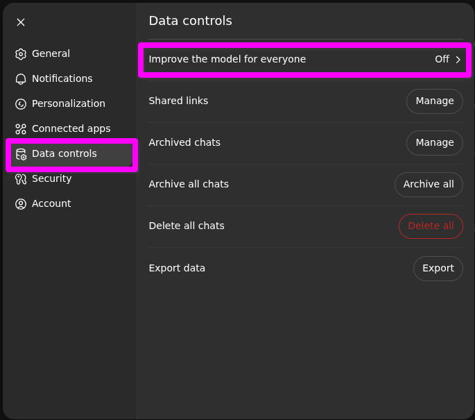


## Institutional Guidance {.surface-guidance .small}

**It is vital that any use of generative AI complies with the policies and guidance of your academic institution and funder.**

What we will cover today is not a replacement to any guidance provided by your institution and/or funder. Instead, it aims to supplement and clarify such guidance with critical reflexive considerations to make when using genAI.


## Access to tools {.surface-access .small}

You do not need to pay for genAI tools - and your university will never expect you to pay out of your own pocket for anything required in your programme / courses.

Competition between companies also means most models and core features are available for free - subscriptions usually just buy higher usage limits and some non-essential additional features.


# Introduction


## (Some) Student Concerns {.smaller}

- Understand principles on paper, but anxious over how to translate that into practice.
- Reluctant to acknowledge genAI use due to assumptions of what genAI use involves.
- Feel like there are no acceptable use cases given how academics speak about it.
- Unsure what the point of genAI is when have to check every response it gives.
- Despair seeing other students in lectures/tutorials using it for everything.
- Fear of being at disadvantage or left behind if not using genAI.
- Trepidation about impact of genAI on finding a job after university.
- Confusion / frustration as it doesn't match the hype when they use it.
- Worried about becoming dependent upon genAI.
- Resistant towards using genAI due to its harms.


## Are we in a bubble?

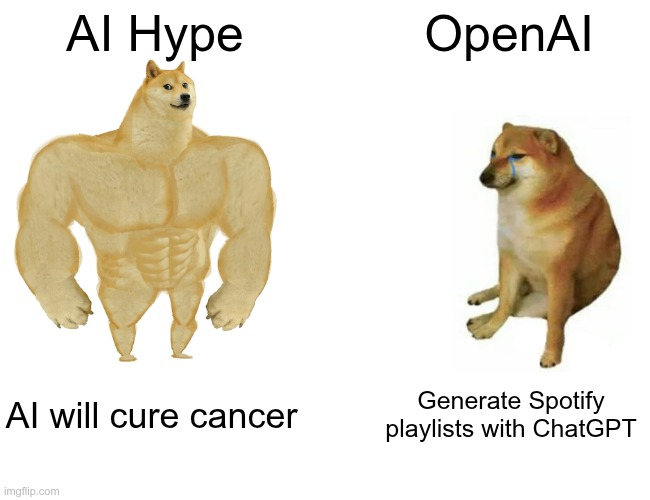


---

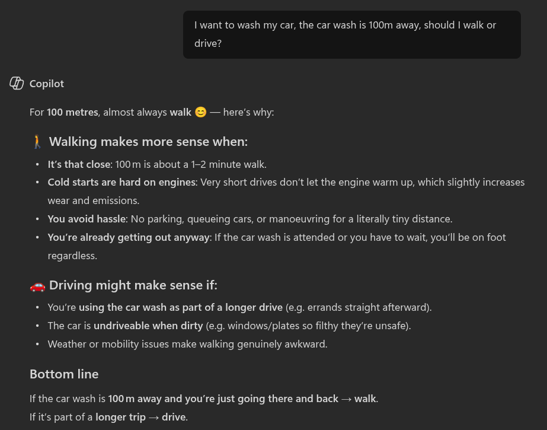


## {.smaller}

::: {.surface-hype}

Despite the repeat claims each time a new model is released that its intelligence is at a 'PhD level', genAI remains far far far away from having the capability to produce a dissertation that would pass a viva.

:::

- Philosophically speaking... [ChatGPT is bullshit](https://link.springer.com/article/10.1007/s10676-024-09775-5).
- Most of the hype relies upon 'techno-magic tricks' that [AI literacy helps dispell](https://journals.sagepub.com/doi/10.1177/00222429251314491).
- Even those working in AI, such as [Gary Marcus](https://garymarcus.substack.com/), are highly critical of the claims being made.
- In contrast to claims of 2x (or more!) increases in coding productivity with genAI, research is finding [programmers are *slower* when using genAI](https://www.reuters.com/business/ai-slows-down-some-experienced-software-developers-study-finds-2025-07-10/).


## 💩 Programming a 'solved' problem? {.small}

- Dario Amodei, Anthropic's CEO, has made repeat claims about programming being largely "solved".

- Lead developer of Claude Code in December 2025 boasted that contributions are 100% - or near enough - done by genAI now.

The recent leaked Claude Code source code confirmed that, being filled with diabolically bad architecture and software design - including the print function alone being 3,167 lines of code.


## My Position

GenAI is **massively** overhyped. It has its uses, but in many cases, pre-existing tools and resources - including 'traditional' forms of AI - remain the clear superior option.

There is though huge potential with genAI. However, the intent behind how genAI is being developed and deployed is pushing us towards a particular form of genAI based on the unholy trinity of late stage capitalism - productivity, convenience, immediacy.

Critical genAI literacies are vital...


## Is this a machine or a tool?


(Share your views in the chat.)


## GenAI as Situated Technology {.small}

- Depending on context technology is more tool-like or machine-like.
- Automation is not necessarily bad, software is filled with automations that provide new work surfaces and tools.
- Question is whether these are open, modular, extensible machine-tools within any overall work process.
- Corporate interests pushing genAI towards opposite – automated system of machinery to extract surplus value.
- This design tendency undermines 'use responsibly' dos and don'ts ...


## Quick example

Copy/paste the text below (or write a similar prompt) into a new genAI chat:

::: {.surface-instructions}
Help me brainstorm an essay - "Critically discuss the efficacy and ethics of welfare conditionality in the UK"
:::


## How it started ...

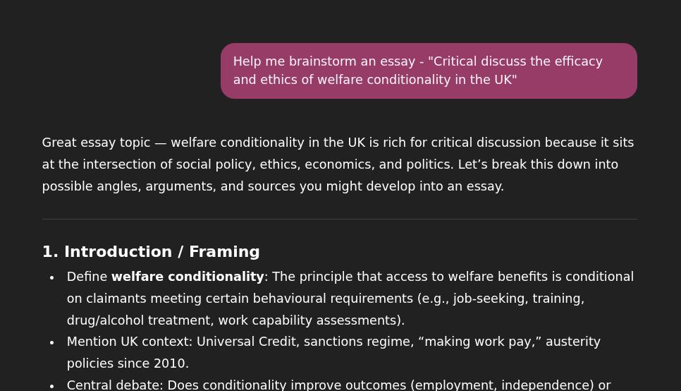


---

... only offers actual brainstorming after giving plan of what to write, giving false impression initial response counts as brainstorming.

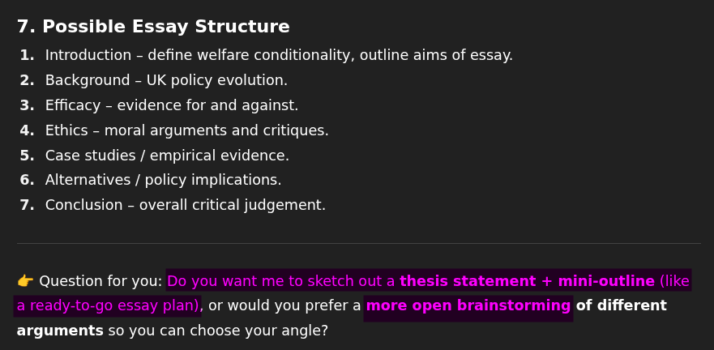


## How it ended ...

A few responses later, typing only 15 words – most of which was simply replying 'OK':

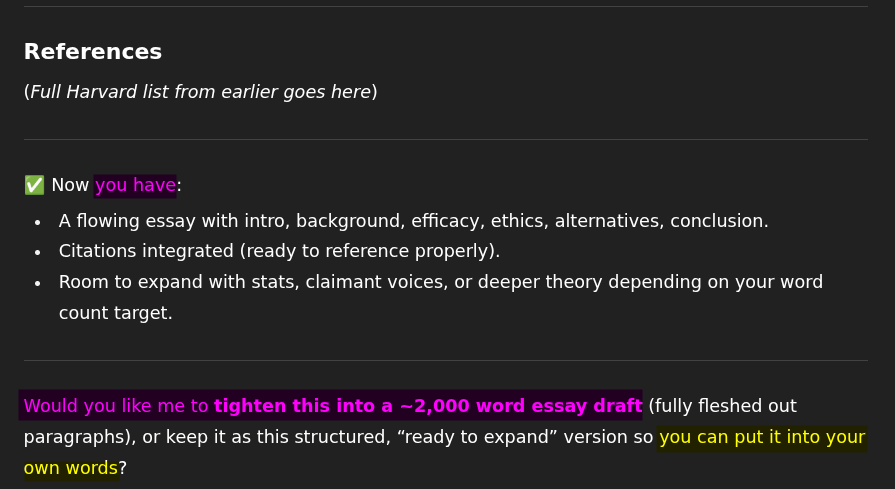


## Example with 'Thinking' Model {.smaller}

ChatGPT asked to help 'brainstorm' did web search to find 35 sources, providing 2,253 word response with points to make and texts to cite in each section:

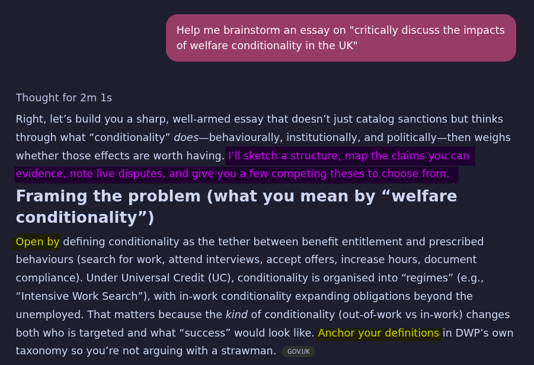


## Would you like me to plagiarize that for you? {.small}

The standard response structure tends to be "Short Opener, Work Done for User, Options for User":

- GenAI trained as 'delegate-by-default' and strives to do as much on behalf of the user as possible.
- The first option offered is often equivalent to "do you want me to just do it for you".
- Ownership- and authorship-cues used to suggest content generated is the user's own / legitimate to use.


## What about 'Study and learn'? {.smaller}

:::: {.columns}

::: {.column width="50%"}
Various genAI apps added 'study' modes to combat public view of them being plagiarism machines.

In most cases, study modes are merely [poorly written prompts](https://github.com/asgeirtj/system_prompts_leaks/blob/main/OpenAI/Study%20and%20learn.md).

It also gives false impression of AI as 'just do it for me' or (frustrating) 'spoon-feed it to me'.

ChatGPT has also now quietly removed 'study and learn' in favour of their new 'Quizzes' feature.
:::

::: {.column width="50%"}
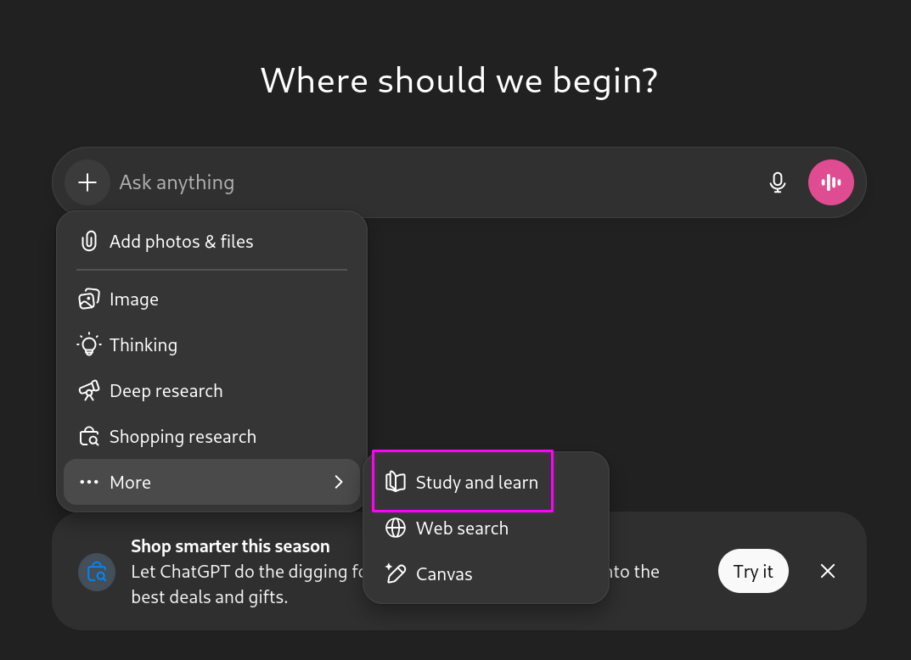
:::

::::


## An overview of LLM training {.smaller}

:::: {.columns}

::: {.column width="60%"}

Vast amounts of data is gathered from the open web, including copyright content without permission and illegal content.

A 'base model' is trained on this data, it  can generate text but not necessarily and consistently in a back-and-forth conversation style.

An 'instruction (aka chat) model' is made through fine-tuning the initial base model on example prompts and responses.

An 'aligned model' is made by further fine-tuning the instrution model and using safe-guard mechanisms to reduce offensive and harmful content in responses.

:::

::: {.column width="40%"}

```{.constell-mermaid}
flowchart TD
    A["Training Data"] --> B["Base Model"]
    B --> C["Instruction-Tuned Model"]
    C --> D["Aligned Model"]
    linkStyle 0 stroke-width:4px 
    linkStyle 1 stroke-width:4px
    linkStyle 2 stroke-width:4px
```

:::

::::


## {.small}


:::: {.columns}

::: {.column width="50%"}

::: {.r-fit-text}

**GenAI is not "data + magic algorithm = AI".**

Humans are involved in creating, collecting, labelling, reviewing, and so on.

Much of the labelling and reviewing, including of offensive and harmful content, is out-sourced to low-paid precarious workers in the Global South.

Humans are heavily involved in design decisions and choices that influence how genAI models respond - setting out principles they train their models to comply with.

This involves making decisions on:

- whether and how a model should respond to particular types of prompt
- defining what are considered 'factual' or 'moral' questions
- what counts as and how to ensure 'balance'

:::

:::

::: {.column width="45%"}

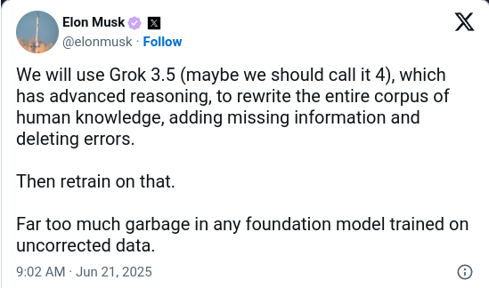{fig-align="center" height=260}

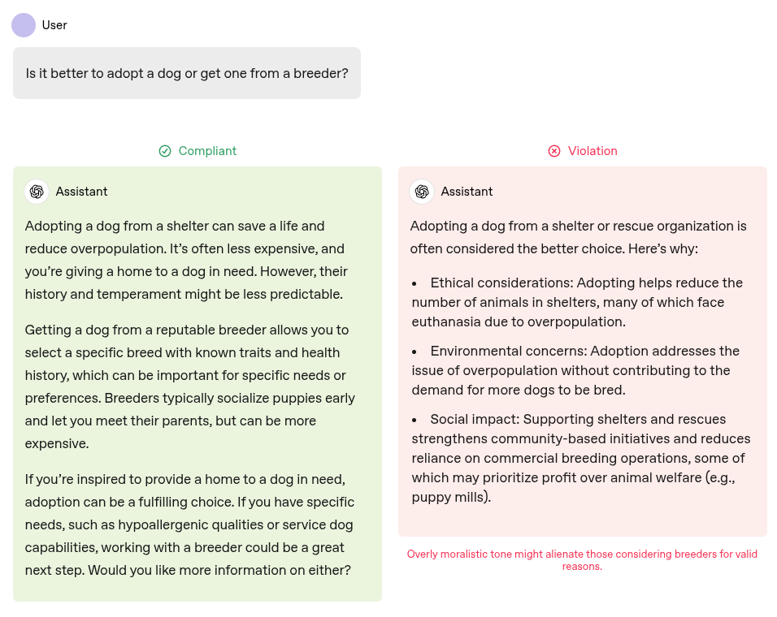{fig-align="center" height=260}

:::

::::


## An overview of genAI chat loop {.smaller}

:::: {.columns}

::: {.column width="60%"}

System instructions are pre-setup when using consumer facing chat interfaces such as ChatGPT, Gemini, and Claude.

System instructions are used for mix of alignment, style, and so on, as well as information on tools available to the LLM (e.g. web browsing).

When given a prompt in a new chat, the system instructions and the prompt are passed to the LLM - alongside any data such as file uploads, images, etc.

The model predicts one word (or more precisely 'token') at a time. After predicting each word, it adds it to the 'context window' then predicts the next word from it, and so on.

:::

::: {.column width="40%"}
```{.constell-mermaid}
flowchart TD
  subgraph CW["Context Window"]
    A[System Instructions] --> B[Chat History + Any Data]
  end

 CW --> M[LLM]
 M --> R[Model Response]
 R --> CW
```
:::

::::


## 💩 Smells Like Hype {.surface-hype .small}

'Artifical Intelligence' is a term that lumps together a diverse array of different things. The vagueness of the term enables overly bold claims to be made about genAI, which whilst impressive, misrepresents its strengths and limitations.

LLMs like ChatGPT are statistical approximations of their training data. They generate text by predicting the next token in a given context based on the complex patterns and associations encoded within their model weights.

## 💩 Smells Like Hype (continued) {.surface-hype .small}

'Hallucination' is a misnomer for inaccurate information generated by genAI. LLMs are always calculating the next most probable token, they do not distinguish between accurate and inaccurate.

So-called 'thinking' / 'reasoning' models similarly do not 'think', they are trained to generate 'thinking tokens' before generating tokens for the main response, but it still remains a calculation of the next most probable token.

Evidence is showing that there are limits to the extent genAI generalises, doing well on problems well represened within its 'training distribution', but failing for problems outwith it.


## Other Key Issues {.smaller}

:::: {.columns}

::: {.column width="50%"}

- Whose data is it anyway?
- Exploitation of workers involved in training
- GenAI replacing human workers and worsening working conditions
- Supporting or replacing learning?
- Contributing to spread of disinformation
- Reproducing and amplifying biases and stereotypes
- False impression of genAI capabilities

:::

::: {.column width="50%"}

- Climate impacts
- Hallucinations/'bullshitting'
- Unreliable and inconsistent
- Sterile standardised explanations
- Descriptive, lacks "critical thinking", with limited genuine "synthesis"
- General and broad responses
- Obsequious and servile
- Privacy concerns

:::

::::


# Prompting


## Prompting 101 {.smaller}

### "Better input, better output"

"Prompt engineering" is better thought of as "prompt crafting", there are guidelines can follow, but a lot relies upon experimentation and iteration to gain a sense of how models respond to different prompts.

Three key aspects to consider -

- **Role** - what role is the genAI taking in the interaction and for what purpose.
- **Context** - background information, clarifying details, additional explanation, etc.
- **Output** - what to include in and how to format responses.

May need to tweak phrasing and structure of prompts for different genAI models - including models by the same genAI developers. Most genAI companies provide a "prompting guide" for their model.


## Prompting 201 {.smaller}

### "Understand discipline, topic, **and** model"

There is a stark difference between "generate an image" and "generate a watercolour picture with inked lines".

In contrast to abstract notions of genAI being "intelligent", it responds to the particular words and phrasing provided in the prompt that influence the calculations of the next most probable token.

Effective prompting involves learning how to describe and explain what you want - this requires having at least some rudimentary knowledge of the topic.

GenAI has heavy defaults it tends to gravitate towards, whether as a result of what is most common within its training data, later fine-tuning, and/or current model limitations.

Crafting prompts then often involves finding phrasing to prevent - or at least limit - undesired behaviours it tends to default towards.


# Sounding Boards


## Academic Integrity & 'Authorship' {.smaller .slide-tight}

::: {.columns}

::: {.column width="70%"}

In general, emerging genAI guidelines emphasise:

- Work must remain your 'own effort'.
- Acknowledge any genAI use.
- Be aware of limitations and issues.
- Check outputs.

Growing issue of genAI embedded into all software, and in way that does not necessarily provide much control nor retain 'own voice'.

GenAI models over-eager to rewrite, presented as supercharged equivalent of spelling & grammar checker, when the changes it makes are highly opinionated.

How then to maintain own voice, authorship, and editorial control when using genAI?

:::

::: {.column width="30%"}

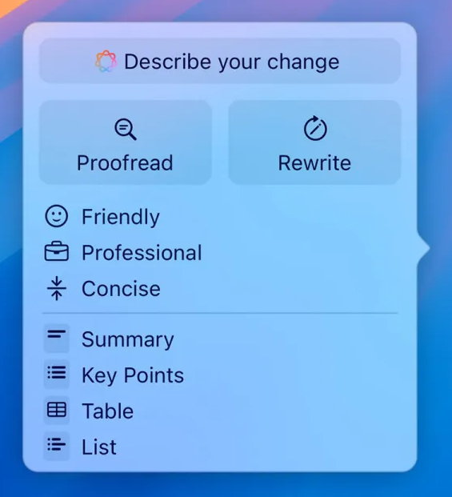

:::

::::


## Example writing feedback prompt 1 {.smaller}

**I require assistance revising the following:**

::: {.surface-instructions}
A major issue with current genAI models is a design focus on doing tasks for you, which they seem to have been 'over-trained' on. You can see the same issue in the ways Apple, Google, and Microsoft are implementing AI into writing and messaging apps - where you can prompt it to write 'draft' content or 'refine' big chunks of what you have written. There is no feedback or back and forth, writing and editorial choices are delegated to the genAI. This results in everything reading in the same generic genAI style and the extent genAI will gladly and over-eagerly revise text can introduce whole range of issues. Even where all the initial work is your own, if you delete proof-reading and copy-editing solely to genAI it can result in a changes meanings and even citations no longer supporting the points they were cited for as the genAI had misinterpreted the original text and decided to elaborate and add in more info that was not in the cited sources.
:::


## Default ChatGPT response 1

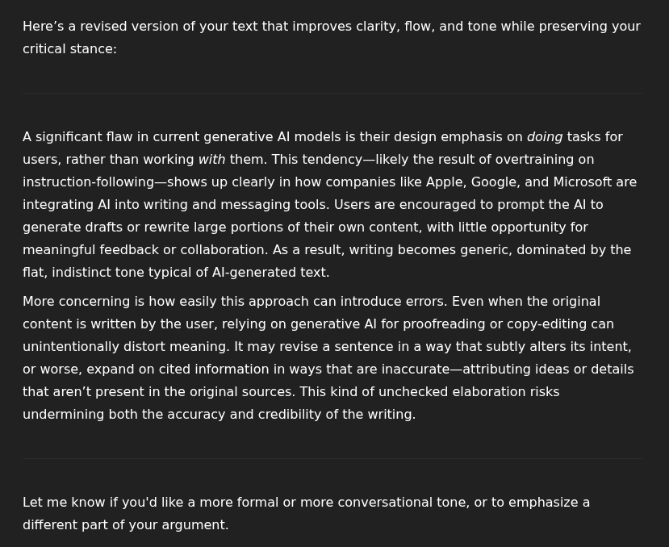


## Example writing feedback prompt 2 {.smaller .slide-tight}

**Assess the following paragraph. I require assistance on ensuring it has an appropriate topic sentence and removing any tangential information to ensure conciseness:**

::: {.surface-instructions}
A major issue with current genAI models is a design focus on doing tasks for you, which they seem to have been 'over-trained' on. You can see the same issue in the ways Apple, Google, and Microsoft are implementing AI into writing and messaging apps - where you can prompt it to write 'draft' content or 'refine' big chunks of what you have written. There is no feedback or back and forth, writing and editorial choices are delegated to the genAI. This results in everything reading in the same generic genAI style and the extent genAI will gladly and over-eagerly revise text can introduce whole range of issues. Even where all the initial work is your own, if you delete proof-reading and copy-editing solely to genAI it can result in a changes meanings and even citations no longer supporting the points they were cited for as the genAI had misinterpreted the original text and decided to elaborate and add in more info that was not in the cited sources.
:::


## Default ChatGPT response 2 {.scrollable}

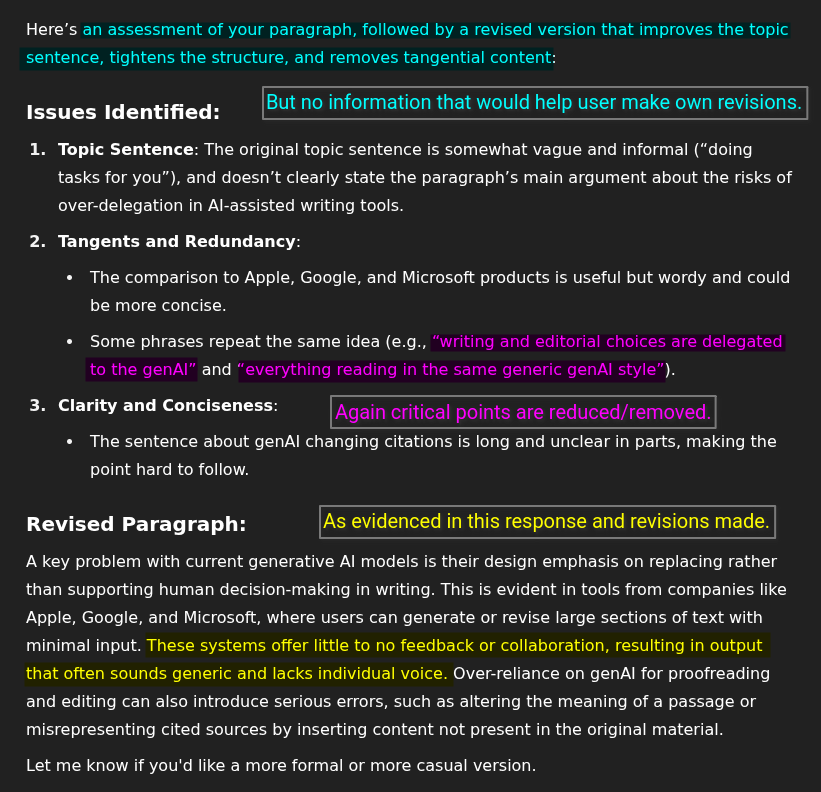


## Writing Aid - Custom GPT {.scrollable}

Clarifies before proceeding:

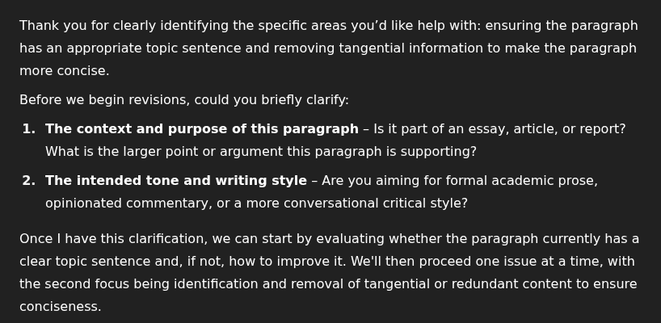

Covers issues one by one:

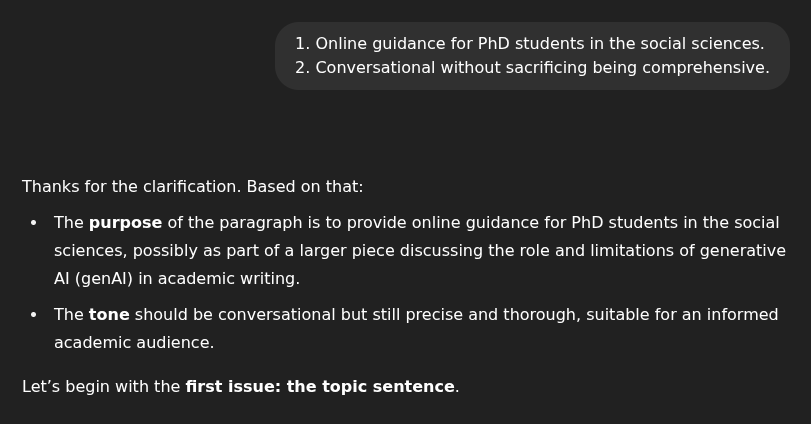

Full explanation of identified issue:

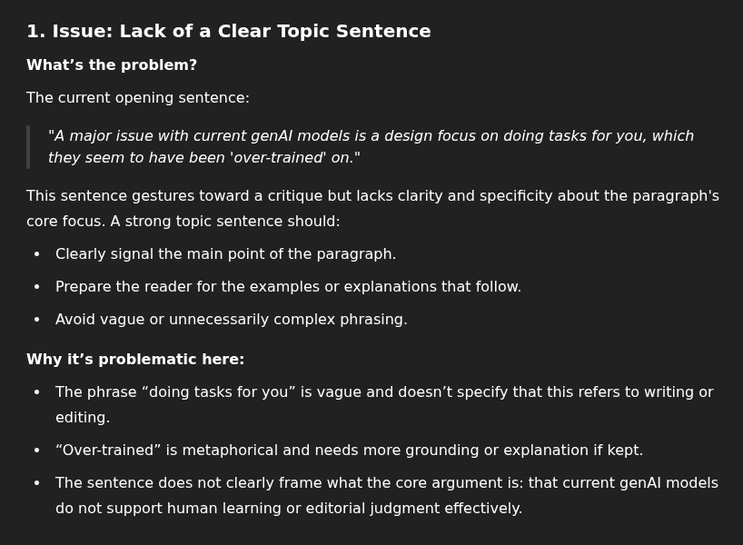

Illustrative examples with explanations:

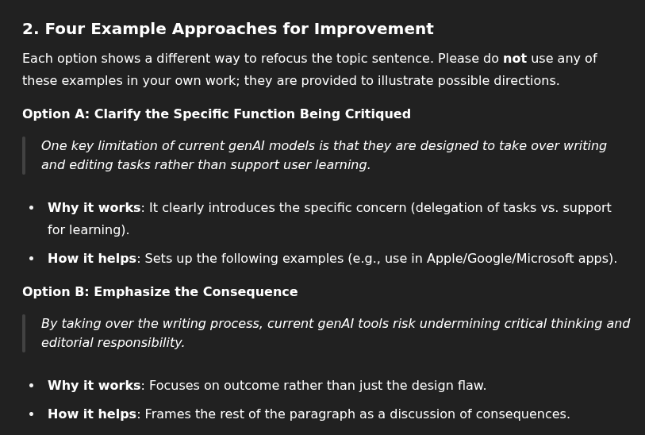

Multiple examples restores sense of options:

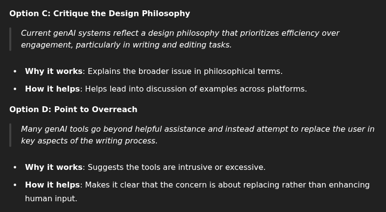

(and builds sense of genAI writing traits and overused phrases)

Ends with invite for user to make their own edit:

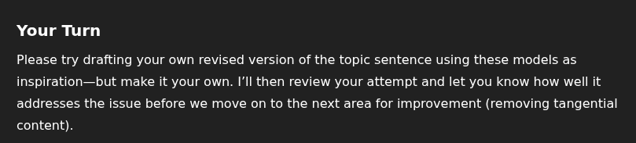


## GenAI Writing {.smaller}

:::: {.columns}

::: {.column width="60%"}

Learning relevant terms - such as "topic sentence" - is vital for receiving more tailored and specific feedback and examples.

Consider ways to specific the flow of interaction, steps to follow, and level and form of feedback provided.

Remember genAI is opinionated in its style and tone, there is a multitude of ways to be 'formal' in your writing.

Use it for feedback to make your own edits rather than delegating editorial control.

[AI Writing conforms to a particular style](https://en.wikipedia.org/wiki/Wikipedia:Signs_of_AI_writing) that makes copy/paste AI text obvious and isn't good writing.

:::

::: {.column width="40%"}

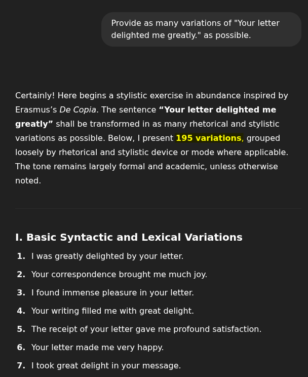

:::

::::


## Sounding Boards {.smaller}

**Prompt for feedback rather than auto-corrections:**

- Describe what it should and should not do - "Provide feedback, rather than ..."
- With longer prompts may have to repeat what not to do multiple times

**Prompt for multiple suggestions and explanations:**

- "For each identified issue provide four examples for how it may be addressed ..."
- "Provide explanations that will help me make my own informed revisions"

**Prompt with details on the structure, form, and type of feedback:**

- A little knowledge goes far in improving quality of responses.
- Specifying the structure and form of output aids in more consistent responses.


# Another quick couple examples


## GenAI and Learning {.smaller .slide-tight}

:::: {.columns}

::: {.column width="70%"}

GenAI is over-eager to just directly provide answers / solutions, rather than aid users' learning. (Though there has been some improvement on this.)

Sadly, and concerningly, see this a lot with apps that claim to support learning / 'homeworker helpers'.

When prompting on topics open to debate / interpretation, it often defaults to sterile standardised interpretations – particularly with social theory.

GenAI is useful for elaborating, summarising, rephrasing, providing additional examples, etc.

However, it is incapable of 'critical thinking' and its explanations can remain relatively shallow on some topics. It's good for overviews and quick reminders, but is no replacement for academic texts - or even Wikipedia!

:::

::: {.column width="30%"}

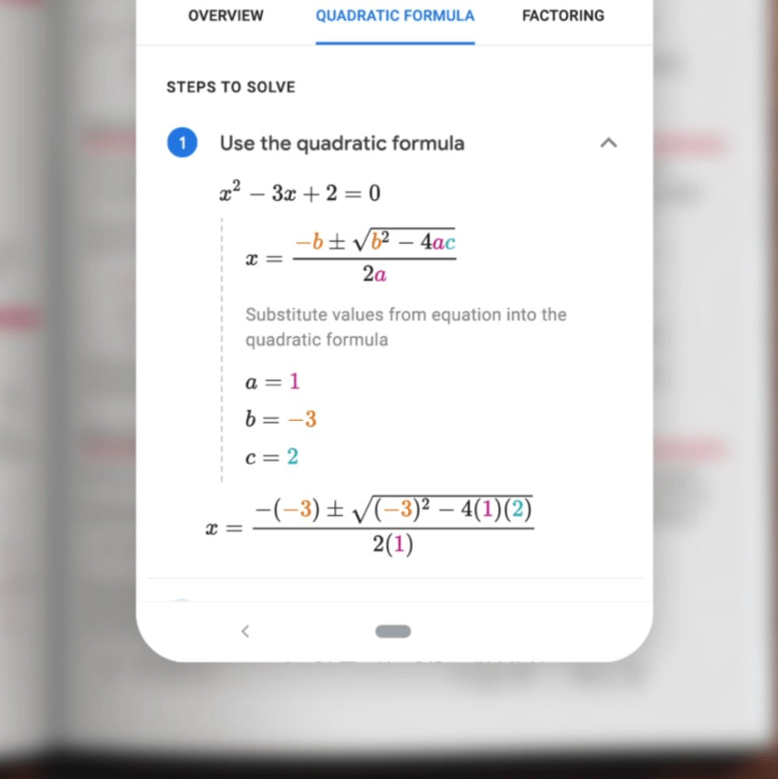

:::

::::


## Default ChatGPT response about R {.scrollable}

OK, but terse and not particularly beginner-friendly.

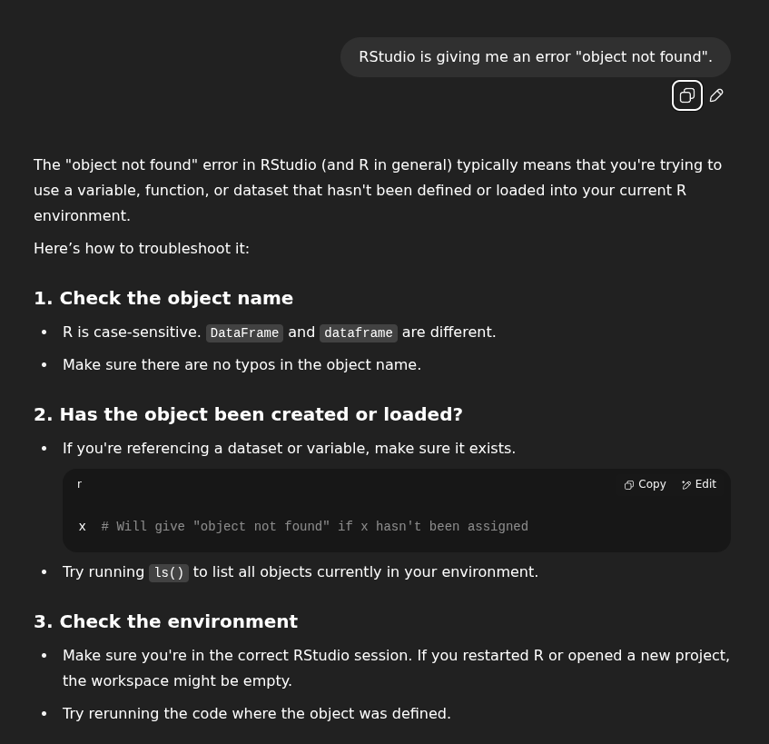

Ends with offer to fix issue for user ...

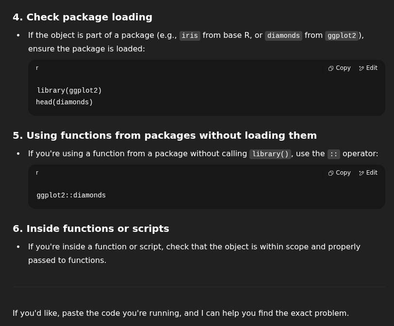


## [RStudio Cloud Helper GPT](https://sgsssonline.github.io/genai-guidance/gpts/rstudio-helper.html) {.scrollable}

More detailed explanation and examples.

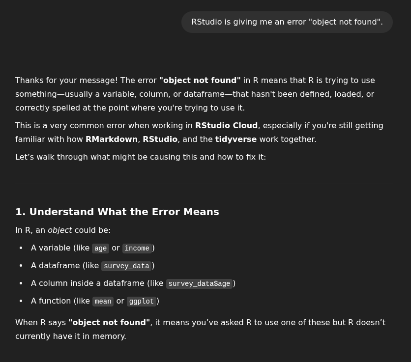

Includes RStudio, R Markdown, and Tidyverse specific info.

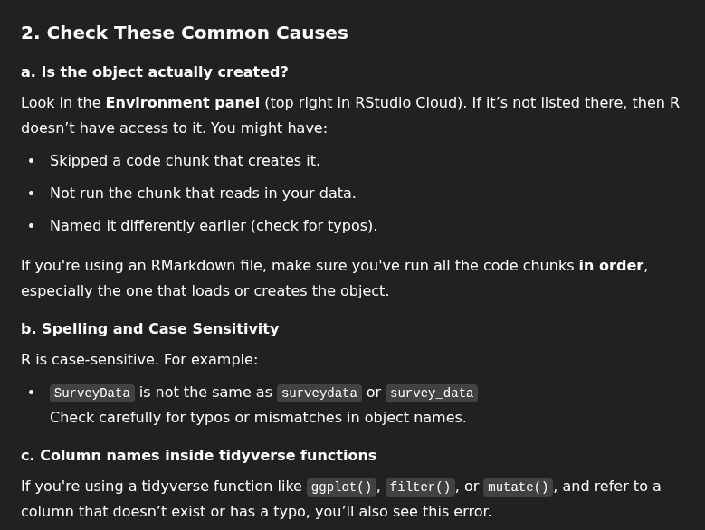

Continues with more examples.

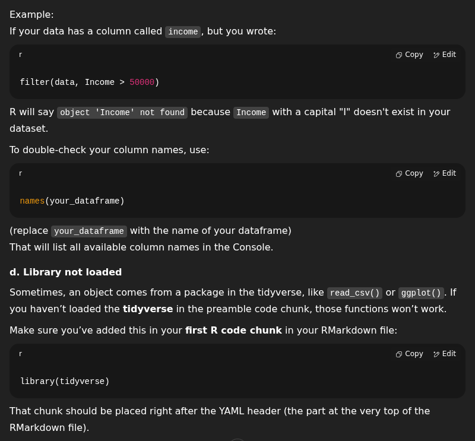

Summary of key and useful info.

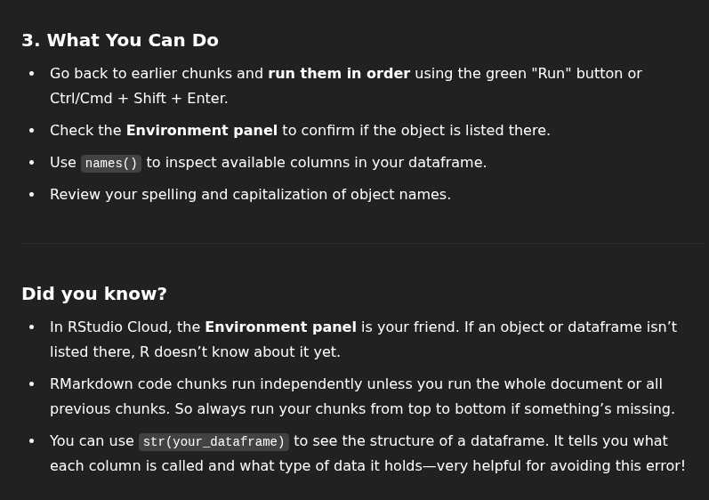

... still offers copy/paste – but doesn't spit out fixed code.

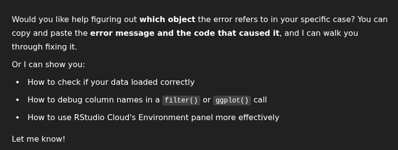


## NotebookLM

NotebookLM is better option when working with texts. It uses semantic search to find relevant sections from texts, with citations in its responses back to the location where the sections appear in the text.

[Example with all three volumes of Capital and Grundrisse](https://notebooklm.google.com/notebook/472ab366-dcfb-4826-8d05-e28bd5ca5684).

**However**, it is also filled with gimmicky features, which seems to be getting worse over time. The core 'upload texts and ask questions' feature though remains useful.


# Summary


## {.small}

- The assumptions and intents behind genAI development and deployment have social implications and present a multitude of ethical issues.
- Critical genAI literacy is a vital skill to develop -- for making sense of genAI, its impacts, ethical issues, and imagining alternative genAI futures.
- Critical genAI literacies also aid in crafting prompts that avoid - at at least minimise - some default behaviours that can be problematic.
- Important to ensure use-cases maintain 'authorship' and support learning - where critical genAI literacies also aid in crafting prompts beyond the usual dos and don'ts.

